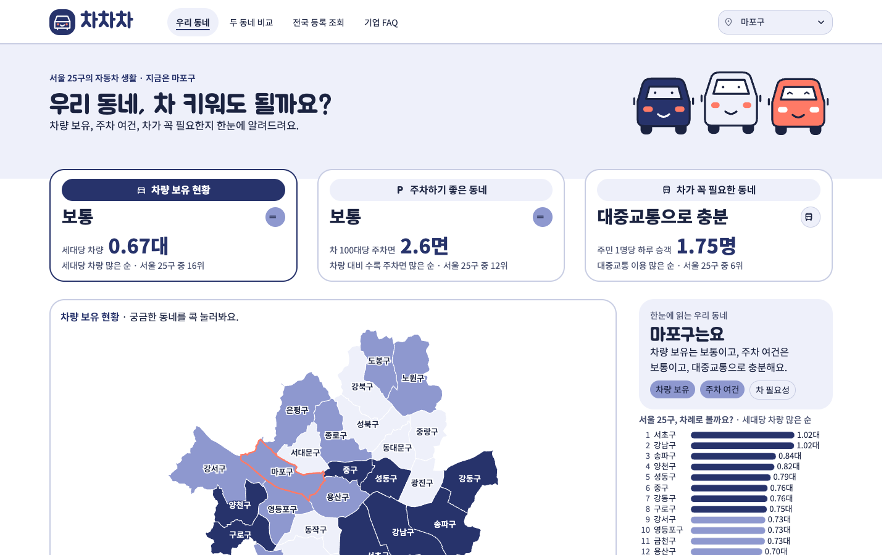
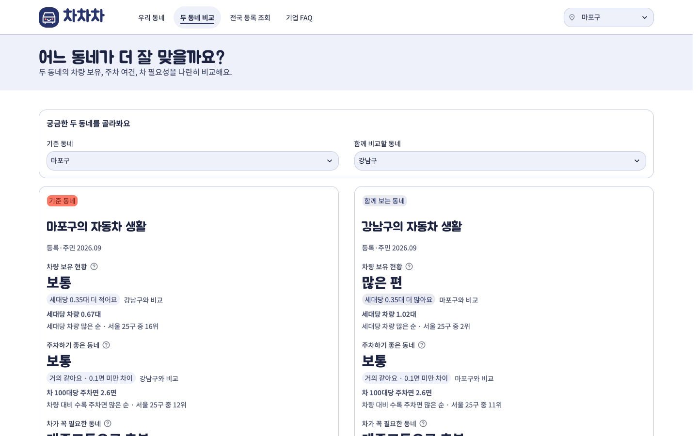

# 차차차


## 세 개의 차

| 차 | 뜻 | 화면의 질문 |
|---|---|---|
| 첫 번째 **차** | **차**량 보유 현황 | 이 동네 사람들은 차를 얼마나 갖고 있나요? |
| 두 번째 **차** | 주**차**하기 좋은 동네 | 차 세우기 좋은 동네인가요? |
| 세 번째 **차** | **차**가 꼭 필요한 동네 | 이 동네에서 차가 꼭 필요할까요? |

**차량 보유 현황을 알아보고, 주차·충전 여건을 살펴보고, 내게 차가 꼭 필요한 동네인지 판단하는 서비스입니다.**

**차차차**는 자동차 보유자와 예비 구매자가 서울 25개 구의 차량 보유 현황, 수록 주차 여건, 대중교통 이용 참고값을 비교하는 조회 서비스입니다. 세 항목의 판정과 근거 수치를 함께 제공합니다.

## 프로젝트 목표

공식 과제는 **전국 자동차 등록 현황 및 기업 FAQ 조회시스템**입니다.

- **차량 보유 현황 이해:** 전국 등록 통계를 조회하고, 서울 25개 구의 세대당 등록대수와 전기차 비중을 살펴봅니다.
- **주차·충전 여건 비교:** 같은 구를 기준으로 등록·주차·충전 자료를 연결해 동네별 차이를 보여줍니다.
- **차 필요성 참고:** 하루 수록 승객 수를 주민 수와 비교해 팀이 정한 추정 판정을 제공합니다.
- **근거 있는 정보 제공:** 데이터의 출처·기준 기간·수집일·빠진 값을 보존하고 기업 FAQ 원문으로 이어줍니다.
- **DB 설계와 조회 구현:** 원본 보존, 정규화, MySQL 적재·검산, Python SQL 조회를 하나의 흐름으로 구현합니다.

## 조회 범위

| 메뉴 | 조회하는 자료 |
|---|---|
| 우리 동네 | 세 칸의 판정, 선택 주제의 서울 지도·25구 막대 순위와 동네 요약. 자세한 자료에서 차량 구성·주차와 충전 시설·시간대별 승객과 서울 날씨 조회 |
| 두 동네 비교 | 두 구의 세 판정·근거값·차이·서울 25구 순위를 나란히 표시하고 차종과 전기차 구성 비교 |
| 전국 등록 조회 | 시도·차종·용도 조건에 맞는 합계·서울 등록·시도 수, 시도별 막대와 등록표. 전체 조건의 16개 시도 이름을 모두 표시하고 서울 막대를 코랄로 강조. 2026-09 합계 26,706,123대 |
| 기업 FAQ | 현대 EV FAQ 10문항 조회. 질문·답변 검색과 기업·분류 필터, 답변의 원문 주소와 수집일 |

### 세 판정의 기준

각 지표의 값이 큰 구부터 SQL `RANK()`로 순위를 매기고 **1~8위 / 9~17위 / 18~25위**로 나눕니다. 한 구나 두 구를 선택해도 서울 25구 전체의 순위를 그대로 사용합니다. 동률은 같은 순위이며 다음 순위는 건너뛰므로 각 구간의 구 수가 항상 8·9·8개인 것은 아닙니다. 필요한 값이 없거나 분모가 0이면 해당 지표·순위는 결측, 판정은 **자료 없음**입니다.

| 판정 | 비교하는 값 | 1~8위 / 9~17위 / 18~25위 |
|---|---|---|
| 차량 보유 현황 | 같은 기준월의 전체 등록대수 ÷ 세대수, 대/세대 | 많은 편 / 보통 / 적은 편 |
| 주차하기 좋은 동네 | 관리번호 충돌을 제외한 수록 주차면 ÷ 전체 등록대수, 면/대 | 좋음 / 보통 / 빠듯함 |
| 차가 꼭 필요한 동네 | 2026-10-30 하루 `total` 승객 부분합 ÷ 선택 등록월 주민 수, 승객/주민 | 대중교통으로 충분 / 있으면 편함 / 차가 필요한 편 |

쉽게 말하면 **한 세대가 차를 얼마나 갖는지**, **차량 수에 비해 수록 주차면이 얼마나 있는지**, **주민 수에 비해 하루 대중교통 이용이 얼마나 많은지**를 각각 비교합니다. 화면의 주차 값은 SQL의 면/대 값에 100을 곱한 **차 100대당 주차면**입니다. 차 필요성의 순위는 **대중교통 이용 많은 순**이며 1위가 차를 가장 필요로 한다는 뜻은 아닙니다.

등록·인구·세대는 **2026-09 한 달** 자료이므로 전월 대비나 월별 추이를 만들 수 없습니다. 주차 판정은 수록 주차면의 상대 비교이며 모든 주차장의 공급량이나 지금 빈자리를 뜻하지 않습니다. 비충돌 주차행에 면수 결측이 있으면 알려진 부분합은 보존하지만 주차 비율·판정은 자료 없음으로 처리합니다.

차 필요 판정은 **2026-10-30 하루 자료에 따른 추정**입니다. 합계(`total`)에 버스·지하철 값을 다시 더하지 않으며, 하루 24시간 중 빠진 시간이나 승객 합이 있거나 분석유형이 하나로 정해지지 않으면 계산하지 않습니다. **중구·종로구는 출퇴근 유입으로 주민 수 대비 승객 값이 커질 수 있습니다.** 승객 수는 고유 주민 수가 아니며, 이 판정만으로 개인에게 차가 필요 없다고 확정할 수 없습니다. **강서구는 일부 행정동이 빠진 부분합**으로 산출되므로 실제 이용 규모보다 작게 집계될 수 있습니다. 하루 24시간이 있다는 것과 모든 행정동 자료가 있다는 것은 다릅니다.

`scoring.py`의 주차·충전·등록 부담 각 1/3, 70/40 경계 종합점수는 **보조 모델**이며 홈·비교 화면에는 표시하지 않습니다. 화면은 세 판정의 25구 3등분 규칙을 사용합니다. 세 판정·순위·보조점수는 [SQL 조회 코드](db/queries.py)에서 계산합니다.

### 정식 앱 화면과 사용 순서

네 화면은 같은 **navbar(상단 메뉴)와 footer(하단 안내)**를 사용합니다. 홈은 큰 hero(서비스 소개), 다른 메뉴는 제목과 한 줄 소개가 있는 짧은 페이지 머리말로 시작합니다.

| 화면 구역 | 보이는 내용과 역할 |
|---|---|
| Navbar | 전체 폭 아래 경계선, 차차차 로고·이름, **우리 동네 / 두 동네 비교 / 전국 등록 조회 / 기업 FAQ**, 현재 메뉴 표시와 동네 선택. 홈과 비교에서 선택한 동네가 이어지며 전국·FAQ는 각 화면의 필터를 사용합니다. |
| Hero와 세 칸 | 홈의 “우리 동네, 차 키워도 될까요?”라는 큰 제목·한 줄 소개·자동차 세 대 그림 아래에 **차량 보유 현황 / 주차하기 좋은 동네 / 차가 꼭 필요한 동네** 세 칸이 이어집니다. 둥근 칸 안에 판정·근거 숫자·순위를 함께 보여 줍니다. |
| 지도와 막대 순위 | 큰 서울 지도 옆에 **한눈에 읽는 우리 동네**와 25구 막대 순위를 배치합니다. 순위는 목록 안에서 따로 스크롤하지 않고 25개 구를 모두 보여 주며 행을 누르면 해당 동네를 선택합니다. |
| Footer | 서비스 소개·네 메뉴 링크·자료 출처와 기준 기간·수집일·판정의 추정 안내·**SKN 38기 5팀**을 담습니다. 날짜는 `get_filter_options()`의 `snapshots`를 사용합니다. |

**네이비·코랄 테마:** 제목은 Jua, 본문은 Noto Sans KR이며 [.streamlit/config.toml](.streamlit/config.toml)의 글꼴을 따릅니다.

| 색의 역할 | 색상 |
|---|---|
| 주색·지도와 막대의 판정 3단계 | 네이비 `#27336B`, 중간 `#8E98CF`, 연한 바탕 `#EEF0FA` |
| 강조 도형·배지·전국 서울 막대 | 코랄 `#FF7A66`. 본문 글자색으로 쓰지 않으며 코랄 위 글자는 `#7A2418` |
| 본문·보조 글자 | `#1B2340`, `#4A5270`. 진한 지도 영역의 이름표는 흰 글자 |
| 테두리·자료 없음 | `#C8CDE3`, `#E4E7E6` |

지도·막대 순위·세 칸의 판정 표시는 같은 단계 색을 사용합니다. 코랄은 강조에만 사용하며 판정의 중간 단계를 뜻하지 않습니다.



**우리 동네:** 기본 선택은 마포구입니다. 세 칸에서 주제를 누르면 지도 색과 오른쪽 막대 순위가 해당 기준으로 바뀝니다. 지도·막대 순위의 행 또는 navbar의 동네 선택을 바꾸면 세 칸의 판정과 근거값, 요약 문장, 판정 표시가 함께 바뀝니다. 마포구의 차량 보유는 `보통`·세대당 0.67대·16위, 주차는 `보통`·차 100대당 2.6면·12위, 차 필요성은 `대중교통으로 충분`·주민당 하루 승객 1.75명·6위입니다.

`판정 기준과 출처`에서 계산 방법·기준일·수집일을 확인하고, 아래 `자세한 자료`를 열어 근거를 살펴봅니다. 지도 경계는 통계청 2013년 자료로 표시 전용입니다.

| 자세한 자료의 선택 | 보이는 자료와 주의점 |
|---|---|
| 차량 구성 | 전체 차량/전기차 선택, 등록대수·전기차 비중, 차종별 막대와 표. 전기차는 전체 차량에 포함됩니다. |
| 주차·충전 시설 | 주차장/충전기 선택, 유효한 좌표의 지도와 제외 사유. 주차 목록 최대 100건, 충전기 목록 최대 200기이며 좌표 없는 시설도 목록에 남습니다. 충전 속도 전체/급속/완속/미상 조건은 요약·지도·목록에 함께 적용됩니다. |
| 시간대별 승객 | 관측 날짜와 전체/버스/지하철 선택, 시간별 수록 승객 그래프와 부분 관측 안내. 아래 날씨는 수록된 최신 서울 공통 관측값이며 선택 날짜와 다를 수 있습니다. 날짜를 바꿔도 차 필요 판정일은 2026-10-30으로 유지됩니다. |

주차는 수록 주차장만 집계하며 아파트 주차장과 실제 빈자리를 포함하지 않습니다. 충전 운영시간·이용제한은 수집 당시 안내입니다. 강서구에는 일부 행정동의 승객 자료가 빠졌다는 안내가 표시됩니다. DB에 보관한 9월 도로 교통량은 현재 상세 화면의 승객 그래프에 함께 그리지 않습니다.



**두 동네 비교:** “어느 동네가 더 잘 맞을까요?”라는 머리말 아래 `기준 동네`와 `함께 비교할 동네`를 고르면 둥근 카드에 각 구의 세 판정, 근거 숫자, 상대 구와의 차이, 서울 전체 순위를 나란히 보여 줍니다. 같은 구를 고르면 안내를 표시합니다. `차종과 전기차 구성 비교`를 열면 전체/전기차 구성의 막대와 표를 볼 수 있습니다. 주차 표시값이 둘 다 2.6면이어도 원래 값이 달라 순위나 작은 차이가 있을 수 있습니다. 필요성은 승객 값이 적은 쪽을 높게 추정하며, 일부 행정동이 빠진 구가 포함되면 비교 주의를 표시합니다.

**전국 등록 조회:** “전국에는 차가 얼마나 있을까요?”라는 머리말 아래 시도·차종·용도를 고르면 둥근 요약 카드의 선택 조건 합계, 같은 조건의 서울 등록, 수록 시도 수와 막대·표가 함께 바뀝니다. 전체 조건은 26,706,123대·서울 3,150,351대·16개 시도입니다. 막대 차트에는 16개 시도 이름을 모두 표시하고 서울 막대를 코랄로 강조합니다. 서울 외 시도만 고르면 서울 등록은 `선택에서 제외`로 표시합니다. 원본의 `전남광주` 표기는 그대로 보존합니다.

**기업 FAQ:** “자동차 생활, 궁금한 게 있나요?”라는 머리말 아래 기본 10문항에서 `충전`을 검색하면 질문·답변에 해당 말이 있는 5문항을 찾습니다. 기업·분류 조건도 함께 적용합니다. 둥근 질문 상자를 펼치면 원문 내용을 유지한 답변과 기업·분류·수집일, `기업 원문에서 확인` 링크를 볼 수 있습니다. 결과가 없으면 친근한 안내와 `검색 조건 초기화` 버튼을 표시합니다.

| 화면 캡처 | 구분 |
|---|---|
| [우리 동네](docs/screens/01_home.png) | 데스크톱 첫 화면 |
| [우리 동네 전체](docs/screens/01_home_full.png) | 데스크톱 전체 화면 |
| [두 동네 비교](docs/screens/02_compare.png) | 두 구 비교 |
| [전국 등록 조회](docs/screens/03_national.png) | 시도별 등록 조회 |
| [기업 FAQ](docs/screens/04_faq.png) | 질문 검색과 답변 |
| [모바일 우리 동네](docs/screens/05_home_mobile.png) | 모바일 화면 |

## 기술 스택

| 구분 | 기술 | 활용 |
|---|---|---|
| 언어 | Python 3.14 | 수집·정제·DB 조회·화면 로직 |
| 데이터 처리 | Pandas | 자료형·지역 연결·집계·검산 |
| 데이터베이스 | MySQL 8 | 8.0.16 이상 문법의 DDL·FK·CHECK·SQL 조회 |
| 웹 애플리케이션 | Streamlit 1.67.0 | 네 메뉴와 조건별 조회 |
| 시각화 | Altair 5.3.0 | 서울 구 경계·시설·비교 자료 시각화 |
| 공공데이터 | 공공데이터 포털 API 2종 | 한국환경공단 전기자동차 충전소 정보, 기상청 ASOS 시간자료 사전 수집 |
| 크롤링 | BeautifulSoup | 수집한 기업 FAQ HTML에서 질문·답변 추출 |
| DB 설계 | ERDCloud | raw·2NF ERD와 도메인별 설계 |
| DB 확인 | DBeaver | 덤프 복원·테이블·SQL 결과·관계 확인 |
| 협업 | Git·GitHub | 역할별 개발과 변경 이력 관리 |

직접 의존성은 [requirements.txt](requirements.txt), 전체 의존성은 [requirements.lock.txt](requirements.lock.txt)에 기록되어 있습니다. 개발 환경은 Python 3.14.10·Streamlit 1.67.0이며 로컬 MySQL의 버전 문자열은 26.10.0입니다. SQL은 MySQL 8.0.16 이상 문법을 사용합니다.

## 프로젝트 폴더 구조

주요 폴더 구조입니다. 원본·정제 CSV·DB 덤프는 공개 레포에 포함하지 않습니다.

```text
차차차/
├── app.py                         # Streamlit 시작점과 네 페이지 연결
├── app_pages/                     # home.py, compare.py, national.py, faq.py
├── site_shell.py                  # 공통 navbar·hero·페이지 머리말·footer와 사이트 CSS
├── assets/                        # logo.svg, three_cars.svg
├── ui.py                          # 세 칸·지도·동네 요약·25구 막대 순위·표시 단위
├── details.py                     # 등록·시설·이동 상세 조회
├── db/                            # connection.py, queries.py, self_check.py
│   └── sql/                       # 실행용 DDL과 원본 보존용 DDL
├── scoring.py                     # 보조점수의 Python 기준 구현
├── etl/                           # API 수집·FAQ 추출·정제·적재
├── data/                          # 출처·정제 규칙, 로컬 원본·CSV는 공개 제외
├── docs/
│   ├── db_design.md               # DB 설계 기준
│   ├── sql_showcase.md            # 대표 SQL 예제
│   ├── erd_raw.png                # 원본 보존 ERD
│   ├── erd_core.png               # 핵심 테이블 ERD
│   └── screens/                   # 홈·비교·전국·FAQ·모바일 캡처와 배너
├── tests/                         # DB 조회·경계·수집·화면 검사
├── test/                          # ETL·스키마·점수 검사
├── README.md                      # 프로젝트·실행 안내
├── requirements.txt               # Python 라이브러리 목록
├── requirements.lock.txt          # 전체 의존성 기록
└── .streamlit/
    ├── config.toml                # 네이비·코랄 테마, 제목 Jua·본문 Noto Sans KR
    ├── secrets.toml.example       # 접속 설정 항목 예시
    └── secrets.toml               # 로컬 비밀 설정, 공개 제외
```

## ERD

실행 DB는 **18개 테이블·136개 컬럼·FK 25개 관계·총 111,676행**으로 구성되어 있습니다. 서울 구 경계 `region_boundary` 25행과 경계 출처 수집본 1행을 포함합니다. 초기 원본 보존용 raw 13표는 실행 DB의 표 수에 더하지 않습니다.

[원본 보존 ERD](docs/erd_raw.png)와 [핵심 테이블 ERD](docs/erd_core.png)를 제공합니다. 실행 정의는 [schema_core.sql](db/sql/schema_core.sql), [schema_active_ext.sql](db/sql/schema_active_ext.sql), [schema_boundary.sql](db/sql/schema_boundary.sql)를 기준으로 합니다. 충전기 추가 컬럼도 `schema_active_ext.sql`에 포함됩니다. 전체 정의는 [schema.sql](db/sql/schema.sql), 설계 설명은 [DB 설계 문서](docs/db_design.md)에서 확인합니다.

### 8개 도메인

| 도메인 | 테이블 | 역할 |
|---|---|---|
| 기준/코드 | `region`, `vehicle_type`, `fuel_scope` | 서울 구·차종·연료범위 기준 |
| 메타 | `source_snapshot` | 출처·기준 기간·수집일·유효 여부 |
| 차량 등록 | `registration`, `province_registration` | 서울 구 및 전국 시도의 등록대수 |
| 충전 인프라 | `charging_station`, `charger` | 충전소 운영묶음과 기기 상세 |
| 회사/고객지원 | `company`, `faq` | FAQ 제공 기업과 질문·답변 |
| 지역 환경 | `region_context`, `parking_site`, `region_boundary` | 인구·세대, 주차장 관측행, 서울 구 경계 |
| 교통·이동 | `traffic_coverage`, `traffic_snapshot`, `transit_coverage`, `transit_ridership_snapshot` | 기대 관측 범위와 시간별 교통량·승객수 |
| 외부 환경 | `weather_snapshot` | 서울 108번 관측소의 시간별 날씨 |

### 주요 관계

- `region` → `registration` **1:n**: 구별 등록을 연결하고, 구와 차종의 n:m 관계를 등록표로 풉니다.
- `region` → `parking_site`, `charging_station` **각 1:n**: 같은 구의 주차·충전 시설을 모읍니다.
- `charging_station` → `charger` **1:n**: 충전소 설명과 반복되는 기기 상세를 분리합니다.
- `company` → `faq` **1:n**: 한 기업의 질문·답변과 원문 링크를 연결합니다.
- `region` → `region_boundary` **1:1**: 경계의 `region_id`를 PK이자 지역 FK로 사용합니다.
- `source_snapshot` → `region_boundary` 등 수집 자료 **1:n**: 경계 출처 FK를 포함해 수집본의 출처·기간·유효 여부를 추적합니다.

### 공공데이터 연동

공공데이터와 기업 FAQ를 포함한 **출처 10종 + 서울 구 경계 1종**을 사용합니다. 출처 종류와 원본 파일 수, 테이블 수는 서로 다릅니다. 출처 주소·수집일·해시·이용조건은 [데이터 출처 기록](data/SOURCES.md)에서 확인합니다.

| 출처 | 기준·수록량 | 활용·주의 |
|---|---|---|
| ① 국토교통부 통계누리 자동차 등록 | 2026-09, 전국 192행·서울 전체 등록 100행 | 전국 조회·등록 지표, 원본 시도 표기 유지 |
| ② 서울 자치구 연료 등록 | 2026-09, 전기 등록 100행·127,750대 | 전기는 전체 등록에 포함, 중복 합산 금지 |
| ③ 행정안전부 주민등록 인구·세대 | 2026-09, 서울 25구 | 구 연결·세대당 등록 부담 |
| ④ 전국주차장정보표준데이터 | 서울 857행, 비충돌 수록 면수 73,068면 | 식별 충돌 22행은 보존하되 면수 합계에서 제외 |
| ⑤ 한국환경공단 충전 API | 2026-11-06 수집, 13,098 운영묶음·75,607기 | 기본 충전 출처, 속도 분류는 커넥터 기반 추정 |
| ⑥ 서울 공공 충전 목록 | 2026-11-05 수집, 187 운영묶음·429기 | 비교용, 기본 충전 출처와 합산 금지 |
| ⑦ 서울 TOPIS 교통량 | 2026-09, 24구 시간 집계 17,280행 | 강북구 무관측, 10/30~31 교통량 미확보 |
| ⑧ 서울 행정동 승객수 | 2026-10-30~31, 3,600행 | 부분결측 보존, 합계·버스·지하철 중복 합산 금지 |
| ⑨ 기상청 ASOS 시간자료 API | 서울 108번, 2026-10-30~31의 48시간 | 서울 공통 관측, 강수·적설의 빈값을 0으로 바꾸지 않음 |
| ⑩ 현대자동차 EV 에브리케어 FAQ | 2026-11-05 수집 HTML, 질문·답변 10쌍 | BeautifulSoup 추출·DB 저장·키워드 검색 |
| ⑪ 통계청 KOSTAT 서울 구 경계 | 2013년 경계, 2026-11-08 수집, 25행 | `kostat_seoul_boundary`, Apache 2.0, 지도 표시 전용 |

**수집 → 정제 → 적재 → 검산** 순서로 자료를 준비합니다. XLSX·CSV·JSON·HTML과 API 수집본을 Pandas로 정리하고, 지역 연결·자료형·해시를 검사한 뒤 MySQL에 적재합니다.

앱은 유효한 MySQL 수집본을 SQL로 조회합니다. API 2종은 사전 수집에 사용하며 화면에서 실시간 호출하지 않습니다. 기본 충전 자료의 구 미연결 25행은 별도 보류하고, 2013년 경계는 점수 계산에서 제외합니다.

**재배포 조건:** [출처 기록](data/SOURCES.md) 2절에서 공공누리 1유형으로 확인된 자료는 출처표시 조건을 따릅니다. 주차 표준·주민등록 자료와 5절의 API 2종은 재배포 조건이 미확인입니다. 기업 FAQ 원문은 기업 저작물이며 원문 재배포 허락이 확인되지 않아 재배포 불가 대상으로 관리합니다. **DB 덤프·정제 CSV·원본은 공개 레포에 포함하지 않으며**, 데이터 관련 공개 산출물은 **코드·스키마·출처 기록만** 남깁니다.

### MySQL·DBeaver 조회

**18표·111,676행의 DB**를 Python에서 SQL로 조회합니다. MySQL의 PK·FK·CHECK로 관계와 값의 조건을 지키고, JOIN·GROUP BY·CASE·LIKE와 윈도 함수로 집계·순위·판정을 계산합니다. Python은 조회 결과를 표시하며 `scoring.py`로 보조점수의 일치를 검사할 수 있습니다. 111,676행은 모든 테이블의 기록 수 합계이며 등록 차량 대수와 구분합니다.

DBeaver에서는 [대표 SQL 7개](docs/sql_showcase.md)로 25구 판정·등록 구성·충전 속도·주차면·전국 등록·FAQ·경계 25행을 조회할 수 있습니다. SQL 3번의 마포구 충전소는 622곳, 충전기는 3,518기입니다. 정규화·관계·표별 행 수는 [DB 설계 문서](docs/db_design.md)에 정리했습니다.

## 실행 방법

프로젝트의 `.venv`, `.streamlit/secrets.toml`, 데이터가 적재된 `chachacha` DB를 사용합니다. 아래 예시의 프로젝트 경로는 `~/SKN_Study/차차차`입니다.

### 1. 프로젝트 폴더와 환경 확인

```bash
cd ~/SKN_Study/차차차
.venv/bin/python --version
.venv/bin/python -m streamlit version
```

현재 환경은 Python 3.14.10, Streamlit 1.67.0입니다. 기존 가상환경에서는 바로 2번으로 진행합니다. 다른 로컬 환경을 처음 준비할 때만 Python 3.14로 가상환경을 만들고 의존성을 설치합니다.

macOS에서 `.venv`가 없는 경우:

```bash
python3.14 -m venv .venv
.venv/bin/python -m pip install -r requirements.txt
```

### 2. DB 접속 설정

설정 파일이 없으면 [설정 예시](.streamlit/secrets.toml.example)를 복사합니다. 다음 명령은 기존 설정을 덮어쓰지 않습니다.

```bash
if [ ! -f .streamlit/secrets.toml ]; then
  cp .streamlit/secrets.toml.example .streamlit/secrets.toml
fi
```

새 환경에서는 팀이 관리하는 접속 설정을 로컬 편집기에서 입력합니다. DB 이름은 `chachacha`입니다. [연결 코드](db/connection.py)는 `st.secrets["mysql"]`을 우선 사용하고 secrets에 없는 항목은 `MYSQL_*` 환경변수 또는 코드의 기본값을 사용합니다. **`.env` 파일을 자동으로 읽지는 않습니다.** 설정 변경 후에는 실행 중인 앱 프로세스를 다시 시작합니다. 실제 접속값은 출력하거나 문서·채팅·공개 레포에 넣지 않습니다.

### 3. 데이터 준비와 조회

프로젝트 DB의 수록량은 **18표·111,676행**입니다. 데이터가 준비된 DB에서 [대표 SQL](docs/sql_showcase.md)을 실행해 조회 결과를 확인합니다.

DB 덤프·정제 CSV·원본은 공개 레포에 포함하지 않으므로 팀 내부 전달본이나 [출처 기록](data/SOURCES.md)에 따른 직접 수집본이 필요합니다. 공개 포털의 최신 파일은 이 문서의 수집본과 내용이 다를 수 있습니다.

### 4. Streamlit 실행

프로젝트 가상환경의 Python으로 실행합니다.

```bash
.venv/bin/python -m streamlit run app.py --server.headless true --server.address 127.0.0.1 --server.port 8510
```

브라우저에서 `http://127.0.0.1:8510`을 엽니다. 접속 설정을 변경한 뒤에는 앱을 다시 시작합니다.

## 팀 역할

팀 5명이 역할별로 작업을 나누고 공통 파일의 변경을 함께 확인합니다.

| 역할 | 맡는 일 |
|---|---|
| PM | 범위·일정·사업성 가설·배포와 발표 준비 조율 |
| 프론트 | Streamlit 화면·지도·메뉴 전환·시연 |
| 백엔드A | API·FAQ 수집·정제·데이터 출처 관리 |
| 백엔드B | ERD·MySQL 적재·SQL 조회·DB 복원 |
| 서포터 | 데이터 확인·문서·발표 자료 |

- 실제 `.streamlit/secrets.toml`, API 키·DB 비밀번호, `.venv`는 업로드하지 않습니다. 설정 항목 예시만 공개 대상입니다.
- DB 덤프·정제 CSV·원본 데이터와 기업 FAQ 원문은 공개 레포에 업로드하지 않습니다.
- 공개 대상은 코드·스키마·출처 기록·설계 문서입니다. 업로드할 파일은 `.gitignore`와 함께 확인합니다.

### 팀 GitHub

[SKNETWORKS-FAMILY-AICAMP / SKN38-1st-5Team](https://github.com/SKNETWORKS-FAMILY-AICAMP/SKN38-1st-5Team)

---

**SK Networks Family AI Camp · SKN38 1st Project · 5Team**
