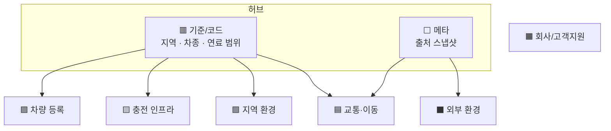
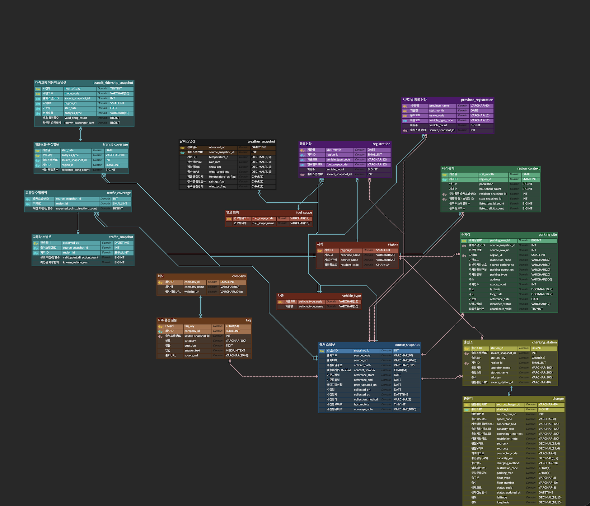

# 🚗 차차차(CHACHACHA) 프로젝트

# 차량 보유 현황을 알아보고
# 차를 주차하기 좋은 동네인지 분석하고
# 차가 필요한 동네인지 판단한다!

| 🅿️ 주차 여건 | 🚦 교통 혼잡도 | 🔌 충전 편의성 |
|:---:|:---:|:---:|
| 이 동네, 차 댈 곳은 충분할까? | 출퇴근길은 얼마나 막힐까? | 전기차 충전은 편할까? |

## 📌 1. Prologue : 서비스 소개

대한민국에서 내 차를 가지고 편안하게 거주한다는 것은 생각보다 까다로운 일입니다. 주차난, 막히는 출퇴근 도로, 그리고 늘어나는 친환경차 인프라까지 고려해야 할 변수가 너무나 많습니다.

**[차차차]** 는 자동차 보유자(그리고 예비 오너)를 위한 **주거지 차량 친화도 입지 분석 플랫폼**입니다. 단순한 지도 검색을 넘어, 사용자의 차량 유형(일반 내연기관차 vs 전기차)에 맞춰 **"이 동네는 차를 가지고 살기 편한가"** 를 점수와 근거로 보여주는 것을 목표로 합니다.

현재는 본격적인 웹 개발에 앞서 기획과 데이터 설계의 기초를 다지는 프롤로그 단계입니다.

## 🛠️ 2. Project Foundation : 지금까지 다진 기초

본격적인 웹사이트 구현에 앞서, 프로젝트의 뼈대가 되는 데이터 규격과 DB 설계를 진행하고 있습니다.

| 항목 | 상태 | 내용 |
|---|---|---|
| 데이터 수집 규격 | ✅ 1차 완료 | 주차 인프라, 교통량, 대중교통 이용 패턴, 기상, 충전 인프라, 차량 등록 통계의 수집 범위와 형식 정의 |
| DB ERD 설계 | 🔵 보완 중 | 17개 테이블 1차 설계, 8개 도메인 색상 분류 적용. 관계(PK·FK) 재정비 진행 중 |
| 로지컬 / 피지컬 네임 | ✅ 완료 | 모든 테이블과 컬럼을 한글 명칭(로지컬)과 영문 명칭(피지컬)으로 정의해 협업 시 바로 이해할 수 있게 정리 |
| 출처 추적 구조 | ✅ 완료 | 모든 수집 데이터가 출처 스냅샷을 거치도록 설계해 언제, 어디서 가져온 데이터인지 추적 |
| 스코어링 기준 | 🔵 초안 | 공공 통계 기반 지표 후보와 보정 방향 정리. 가중치와 정규화 방식은 Phase 1에서 확정 |

## 🧩 3. Data Architecture : DB ERD 색상별 분류 체계

17개 테이블을 8개 도메인으로 나누고, ERD에서 도메인마다 같은 색을 적용했습니다. 색만 보고도 "이 테이블이 어떤 역할인지"를 바로 알 수 있게 하는 것이 목표입니다.

| 색상 | 도메인 | 테이블 (로지컬 / 피지컬) | 역할 |
|:---:|---|---|---|
| 🟥 | 기준/코드 | 지역 `region` · 차종 `vehicle_type` · 연료 범위 `fuel_scope` | 모든 테이블이 참조하는 기준 정보 (허브) |
| ⬜ | 메타 | 출처 스냅샷 `source_snapshot` | 데이터를 언제·어디서·어떻게 수집했는지 기록 (허브) |
| 🟪 | 차량 등록 | 등록현황 `registration` · 시/도 별 등록 현황 `province_registration` | 지역·차종·연료별 차량 등록 대수 |
| 🟨 | 충전 인프라 | 충전소 `charging_station` · 충전기 `charger` | 충전소 위치와 충전기 속도·커넥터·운영시간 |
| 🟧 | 회사/고객지원 | 회사 `company` · 자주 묻는 질문 `faq` | 충전 사업자 정보와 FAQ |
| 🟩 | 지역 환경 | 지역 통계 `region_context` · 주차장 `parking_site` | 인구·세대수·정류장 수, 공영주차장 위치와 면수 |
| 🟦 | 교통·이동 | 교통량 수집범위 `traffic_coverage` · 교통량 스냅샷 `traffic_snapshot` · 대중교통 수집범위 `transit_coverage` · 대중교통 이용객 스냅샷 `transit_ridership_snapshot` | 시간대별 교통량과 대중교통 이용객 |
| ⬛ | 외부 환경 | 날씨 스냅샷 `weather_snapshot` | 기온·강수·적설·풍속 |

**설계 원칙**

- **허브는 중립색, 업무 도메인은 고유색**: 거의 모든 테이블이 참조하는 기준/코드와 메타 테이블을 업무 테이블과 구분했습니다.
- **수집 범위와 관측값 분리**: 교통·이동 도메인은 "받아야 할 양(수집범위)"과 "실제 받은 양(스냅샷)"을 따로 저장해, 빠진 데이터가 얼마나 되는지 계산할 수 있습니다.
- **원본 보존**: 형식이 제각각인 충전기 정보는 원본 텍스트로 먼저 저장하고, 필요할 때 정규화합니다.

## 🎯 4. Core Features : 핵심 제공 기능 (예정)

**동네별 차차차 종합 스코어 (0~100점)**

- 지도에서 지역을 클릭하면 주차 여건, 교통 혼잡도, 충전 편의성을 종합한 점수와 항목별 세부 지표를 제공합니다.
- 분석 단위는 시군구로 시작하고, 행정동 단위는 데이터를 확보한 뒤 확장합니다.

**맞춤형 예상 주차비 자동 계산**

- 차량 유형(경차, 저공해, 하이브리드, 장애인 등)에 따른 지자체별 공영주차장 요금 감면 혜택을 적용합니다.
- 주차 요금·감면 규칙 데이터는 Phase 1에서 ERD에 추가합니다.
- 차량 유형 정보(특히 장애인 여부)는 서버에 저장하지 않고 화면에서만 계산합니다.

**EV(전기차) 전용 모드 & 신규 충전소 입지 분석**

- 전기차를 선택하면 급속/완속 충전기 수급 비율과 충전기 1기당 전기차 수가 활성화됩니다.
- 수요 대비 충전 인프라가 부족한 **'신규 설치 검토 지역'** 을 도출합니다.

> 💡 충전 대기 시간 예측과 도로 접근성 지표는 실시간 충전기 상태·도로망 데이터가 필요해 다음 단계 과제로 둡니다.

## 🗺️ 5. Development Roadmap : 앞으로의 개발 과정

**Phase 0: 설계 마무리 (진행 중)**

- ERD 관계(PK·FK) 재정비, 주차 요금·감면 규칙 테이블 추가
- 스코어 지표와 가중치 초안 문서화, 기술 스택 확정

**Phase 1: 데이터 파이프라인 및 백엔드 구축 (예정)**

- 공공데이터 포털 및 오픈 API 연동 수집 스크립트 작성 (인증키 발급, 이용허락 조건 확인)
