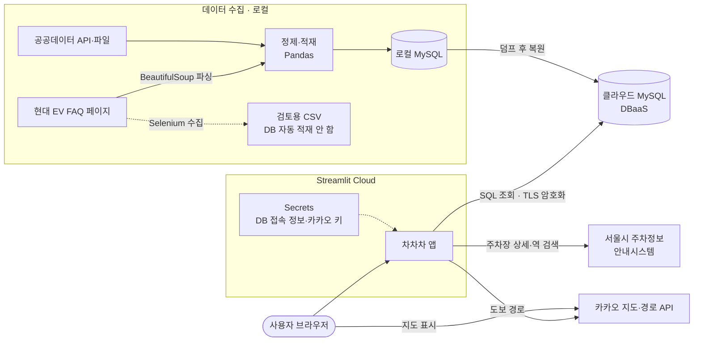

# 차 · 차 · 차 [](https://chachacha.streamlit.app/)

<!-- 구현 영상: GitHub 웹에서 README를 편집할 때 영상 파일을 이 줄 아래로 끌어다 놓으면 주소가 들어가고, 저장하면 재생 화면으로 보입니다. -->

## 팀 소개

| 이름 | GitHub | 맡은 일 |
|---|---|---|
| 고재윤 | [@jjygo](https://github.com/jjygo) | 팀장·PM, 초기 서비스 구상·아이디어, 정규화, 풀스택 |
| 한기현 | [@airnsie-sudo](https://github.com/airnsie-sudo) | 프론트엔드, 화면 구조, 시연 |
| 박채영 | [@chaezero03](https://github.com/chaezero03) | 세부 데이터 항목 구상, 수집·정제, Ul·지도 개선, 보안 |
| 이현지 | [@ira1234847](https://github.com/ira1234847) | 공공데이터 크롤링 |
| 권대원 | [@SorryToT](https://github.com/SorryToT) | 전체 ERD 설계, MYSQL 적재, 문서·UX |

## 프로젝트 소개

공식 과제는 전국 자동차 등록 현황 및 기업 FAQ 조회시스템입니다.

차를 가지고 살 동네를 고를 때는 주차, 출퇴근길, 전기차 충전까지 같이 봐야 합니다. 역세권처럼 자동차 이용자 입장에서 동네를 볼 수 있으면 좋겠다는 생각으로 시작했고, 서울 25개 구의 차량 보유 현황, 주차 여건, 대중교통 이용 수준을 판정과 수치로 비교할 수 있게 만들었습니다.

## 주요 화면

<table>
  <thead>
    <tr><th>구분</th><th>메뉴</th><th>할 수 있는 것</th></tr>
  </thead>
  <tbody>
    <tr><td rowspan="2" align="center">시작</td><td><b>우리 동네</b></td><td>서울 지도에서 구를 고르면 세 판정을 볼 수 있고, 공공 사이트 연결과 바로가기, 서울 자동차 현황이 있습니다.</td></tr>
    <tr><td><b>동네 찾기</b></td><td>내 상황과 중요하게 보는 기준을 고르면 서울 25구를 순위로 추천합니다.</td></tr>
    <tr><td rowspan="4" align="center">동네 보기</td><td><b>차량 보유</b></td><td>구별 차량 보유 현황을 지도로 보고 차종 구성을 서울 평균과 비교합니다.</td></tr>
    <tr><td><b>주차·충전</b></td><td>주차 여건을 확인하고 주차장과 충전소 위치를 지도에서 찾습니다.</td></tr>
    <tr><td><b>대중교통</b></td><td>시간대별 승객 수를 봅니다.</td></tr>
    <tr><td><b>도로와 날씨</b></td><td>실시간 교통 지도와 수록된 교통량·날씨 자료를 봅니다.</td></tr>
    <tr><td rowspan="3" align="center">비교·조회</td><td><b>25구 순위</b></td><td>선택한 구의 판정과 25구 순위, 판정 기준과 출처를 봅니다.</td></tr>
    <tr><td><b>두 동네 비교</b></td><td>두 구의 판정과 수치를 나란히 비교합니다.</td></tr>
    <tr><td><b>조회</b></td><td>시도·차종·용도별 등록 대수를 조회합니다. </td></tr>
    <tr><td rowspan="3" align="center">도움말</td><td><b>기업 FAQ</b></td><td>이용 안내와 현대 EV FAQ를 검색합니다.</td></tr>
    <tr><td><b>물어보기</b></td><td>동네와 자동차 생활에 대해 질문하고 근거 자료를 함께 봅니다.</td></tr>
    <tr><td><b>자료 안내</b></td><td>자료 출처, 기준 시점, 판정 규칙과 한계를 설명합니다.</td></tr>
  </tbody>
</table>

홈을 뺀 지도는 Kakao 지도를 사용합니다(하루 30만건). 카카오 응답은 DB에 저장하지 않고, MySQL에 넣은 공공데이터를 지도 위에 표시합니다.

## 세 판정의 기준

서울 25구를 지표 값이 큰 순서로 세워 1\~8위, 9\~17위, 18\~25위로 나눕니다. 순위는 SQL의 `RANK()`로 계산합니다.

| 판정 | 비교하는 값 | 1\~8위 / 9\~17위 / 18\~25위 |
|---|---|---|
| 차량 보유 현황 | 등록 대수 ÷ 세대 수 | 많은 편 / 보통 / 적은 편 |
| 주차하기 좋은 동네 | 주차면 ÷ 등록 대수 | 좋음 / 보통 / 빠듯함 |
| 차가 꼭 필요한 동네 | 하루 대중교통 승객 ÷ 주민 수 | 대중교통으로 충분 / 있으면 편함 / 차가 필요한 편 |

등록과 인구는 2026년 9월, 승객은 2026년 10월 30일 하루 자료입니다. 주차는 표준데이터에 있는 주차장만 세기 때문에 아파트 주차장과 실시간 빈자리는 포함되지 않습니다. 중구와 종로구는 출퇴근 인구 때문에 승객 값이 크게 나올 수 있고, 강서구는 일부 행정동 자료가 빠져 있습니다.

## 기술 스택

| 구분 | 기술 |
|---|---|
| 언어·데이터 처리 |   |
| 데이터베이스 |    |
| 웹·시각화 |    |
| 수집 |   공공데이터 포털 API |
| 협업 |   |

## 서비스 구조



저희가 가장 먼저 고민한 건 DB 보안이었습니다. 처음처럼 각자 로컬 DB를 쓰면 팀원마다 데이터가 달라지고, 배포하려면 DB 접속 정보를 코드에 넣어야 했습니다. 그런데 저희 저장소는 누구나 볼 수 있는 공개 저장소라서, 접속 정보가 코드에 들어가는 순간 집 열쇠를 현관문에 걸어 두는 것과 같았습니다. 
그래서 저희는 데이터를 저희 컴퓨터가 아닌 외부 클라우드에 두기 위해 DBaaS를 선택했습니다.

## 프로젝트 구조

```text
SKN38-1st-5Team/
├── app.py          # Streamlit 시작점
├── app_pages/      # 화면별 페이지
├── db/             # DB 연결·SQL 조회, sql/에 테이블 생성 SQL
├── etl/            # API 수집·FAQ 크롤링·정제·적재
├── docs/           # DB 설계 문서, 대표 SQL, ERD
└── data/           # 데이터 출처 기록
```

## ERD

테이블 18개, FK 25개, 총 111,676행입니다.


[1차 raw ERD](docs/erd_raw.png) · [초기 ERD](database/erd.png)

ERD 색상별로 나누면 다음과 같습니다.

| 색상 | 묶음 | 테이블 |
|---|---|---|
| 빨강 | 기준 코드 | `region`, `vehicle_type`, `fuel_scope` |
| 흰색 | 수집 기록 | `source_snapshot` |
| 보라 | 차량 등록 | `registration`, `province_registration` |
| 노랑 | 충전 | `charging_station`, `charger` |
| 주황 | 기업 FAQ | `company`, `faq` |
| 초록 | 지역 | `region_context`, `parking_site`, `region_boundary` |
| 파랑 | 교통 | `traffic_coverage`, `traffic_snapshot`, `transit_coverage`, `transit_ridership_snapshot` |
| 검정 | 날씨 | `weather_snapshot` |

교통과 승객 자료는 받아야 할 범위와 실제로 받은 값을 나눠 저장해서 빠진 데이터를 셀 수 있게 했습니다. 수집한 자료는 `source_snapshot`으로 출처와 수집일을 확인할 수 있습니다.

## 데이터 출처

국토교통부 자동차 등록, 행정안전부 인구·세대, 전국주차장정보표준데이터, 한국환경공단 충전소 API, 서울 TOPIS 교통량, 서울 행정동 승객수, 기상청 ASOS API, 현대자동차 EV FAQ, 통계청 서울 구 경계 등 11종을 사용했습니다. 자세한 내용은 데이터 출처 기록에 있습니다.

DB 덤프, 정제 CSV, 원본 데이터, 기업 FAQ 원문은 재배포 조건 때문에 레포에 넣지 않았습니다.

## 앞으로의 계획

- **실시간 정보 연결**: 주차장 빈자리와 충전기 사용 상태처럼 지금 이 순간의 정보까지 보여 주기
- **비교 범위 넓히기**: 서울 25구를 넘어 경기·인천 등 수도권 생활권까지 비교하기
- **생활비 관점 더하기**: 차 유지비와 대중교통비를 함께 놓고 내 상황에 맞는 선택을 돕기
- **더 똑똑한 물어보기**: 질문에 답하는 것을 넘어 개인 상황에 맞춘 동네 추천까지 확장하기
- **자료 자동 갱신**: 공공데이터를 정기적으로 수집해 항상 최신 기준으로 판정하기

## 회고

**고재윤**
> 공식 과제는 '전국 자동차 등록 현황'과 '기업 FAQ' 조회였지만, 차를 가진 사람이 살 동네를 고를 때 실질적인 도움이 되는 서비스로 확장해 보자는 생각에서 출발했습니다. 처음에는 막연한 구상이었으나, 팀원들이 데이터 수집과 DB 설계, 화면 개선을 도맡아 준 덕분에 실제로 동작하는 서비스를 완성할 수 있었습니다. 다만 팀장으로서 진행 상황을 더 자주 나누고 체크하지 못해 막바지까지 팀원들을 바쁘게 만든 점은 아쉬움으로 남습니다. 촉박한 일정 속에서 결코 쉽지 않은 프로젝트였음에도, 저를 믿고 끝까지 함께해 준 팀원들에게 진심으로 고맙습니다. 다음에는 시작 단계부터 일정과 진척도를 함께 투명하게 공유하고, 업무를 세부적으로 나누어 더 효율적인 협업으로 완성도 높은 서비스를 만들고 싶습니다.

**한기현**
> 이번에 첫 팀별과제를 하면서 제가 부족한 부분들이 많이 있었는데 팀원들이 도움을 줘서 어려운 과정을 해결할 수 있었습니다. 앞으로 공부를 더 열심히해서 다음 과제할 때 더 좋은 결과물을 만들겠습니다.

**박채영**
> 이번 프로젝트에서 가장 기억에 남는 건 처음에 손으로 그렸던 구상이 실제 화면으로 이어진 순간입니다. 처음에는 주차장 위치, 요금, 운영시간처럼 어떤 정보가 필요할지 적어봤습니다. 그런데 지도를 만들고 나니 위치를 보여주는 것만으로는 부족했습니다. 핀을 눌렀을 때 요금과 운영시간이 바로 나와야 사용자가 갈 곳을 정할 수 있겠다고 생각했고, 그 부분을 개선했습니다. 이 경험을 통해 어떤 데이터를 모을지 정할 때부터 사용자가 화면에서 뭘 하려는지 생각해야 한다는 걸 배웠습니다. 다음에 비슷한 기능을 만든다면, 먼저 사용자가 한 가지 일을 끝내는 과정을 그려보고 거기에 필요한 데이터부터 정해보고 싶습니다.

**이현지**
> 시간상 남는 것이 힘들어 많이 참여하지 못했지만, 짧은 시간으로도 할 수 있는 일들을 했습니다. 다음번에는 더 참여할 수 있도록 해보겠습니다.

**권대원**
> **고진감래(苦盡甘來) : '쓴 것이 다하고 단 것이 온다'**<br>이번 프로젝트를 시작할 때 "제가 부족한 부분 때문에 팀에 폐를 끼치면 어떻게 할까"라는 걱정이 앞섰습니다. 하지만 팀원들 덕분에 모르는 부분을 하나씩 채워가며 전체 ERD 설계부터 MySQL 적재, 문서와 UX 정리까지 맡은 일을 해낼 수 있었습니다. 완성된 결과물을 보니 저도 팀에 보탬이 되었다는 뿌듯함과 성취감을 느꼈습니다. 아직 발표와 질의응답이라는 큰 산이 남아 있지만, 끝까지 잘 넘어서 유종의 미를 거두고 싶습니다.

---

SK Networks Family AI Camp · SKN38 1st Project · 5Team
