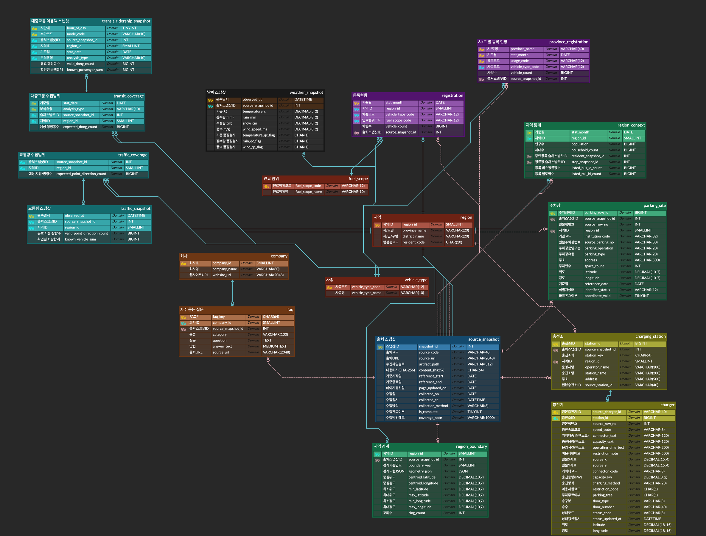

# 차차차


## 팀 소개

| 역할 | 이름 | GitHub | 맡은 일 |
|---|---|---|---|
| 팀장 · PM | 고재윤 | [@jjygo](https://github.com/jjygo) | 범위·일정·발표 준비 조율 |
| 프론트엔드 | 한기현 | [@airnsie-sudo](https://github.com/airnsie-sudo) | Streamlit 화면·지도·시연 |
| 백엔드 | 박채영 | [@chaezero03](https://github.com/chaezero03) | 데이터 수집·DB 구축·SQL 조회 |
| 백엔드 | 이현지 | [@ira1234567](https://github.com/ira1234567) | 데이터 수집·DB 구축·SQL 조회 |
| 서포터 | 권대원 | [@SorryToT](https://github.com/SorryToT) | 데이터 확인·문서·발표 자료 |

## 왜 차차차인가요?

내 차를 가지고 편하게 살 동네를 고르려면 주차난, 막히는 출퇴근길, 늘어나는 전기차 충전 인프라까지 따져야 합니다. **차차차**는 서울 25개 구의 차량 보유 현황, 주차 여건, 대중교통 이용 수준을 비교해 "**이 동네는 차를 가지고 살기 편한가**"를 판정과 근거 수치로 보여줍니다.

> *역세권이 대중교통 이용자를 위한 기준이라면, 차차차는 자동차 이용자를 위한 동네 선택 기준입니다.*

공식 과제는 **전국 자동차 등록 현황 및 기업 FAQ 조회시스템**입니다.

## 주요 화면

| 구분 | 메뉴 | 할 수 있는 것 |
|---|---|---|
| 🏠 시작 | **우리 동네** | 서울 지도에서 구를 고르면 차량 보유·주차 여건·차 필요성 세 판정과 25구 순위를 보여줍니다. |
| 🔍 동네 살펴보기 | **차량 보유** | 서울 25구의 차량 보유 현황과 차종별 구성을 서울 평균과 비교합니다. |
| | **주차 찾기** | 동네의 주차 여건과 공영·민영 주차장 위치를 지도에서 찾습니다. |
| | **전기차 충전** | 충전기 구성과 충전소 위치를 살펴봅니다. (실시간 빈자리 정보는 아님) |
| | **대중교통** | 시간대별 승객 흐름으로 차 없이 다닐 때의 동네 모습을 살펴봅니다. |
| | **도로와 날씨** | 수록된 시간대별 교통량과 날씨 표본을 살펴봅니다. |
| ⚖️ 비교·조회 | **두 동네 비교** | 두 구의 세 판정과 근거를 같은 기준으로 나란히 비교합니다. |
| | **전국 등록 조회** | 시도·차종·용도별 전국 등록대수를 조회합니다. (2026-09 기준 26,706,123대) |
| 💡 도움말 | **차차차 FAQ** | 서비스 이용 안내와 현대 EV FAQ를 검색하고 원문 링크를 확인합니다. |
| | **자료 안내** | 자료 출처, 기준 시점, 판정 규칙과 자료의 한계를 확인합니다. |

## 세 판정의 기준

각 지표의 값이 **큰 구부터** 서울 25구의 순위를 매겨 **1–8위 / 9–17위 / 18–25위**로 나눕니다. 순위는 SQL의 `RANK()` 함수로 계산합니다.

| 판정 | 비교하는 값 | 1–8위 / 9–17위 / 18–25위 |
|---|---|---|
| 차량 보유 현황 | 등록대수 ÷ 세대수 | 많은 편 / 보통 / 적은 편 |
| 주차하기 좋은 동네 | 주차면 ÷ 등록대수 | 좋음 / 보통 / 빠듯함 |
| 차가 꼭 필요한 동네 | 하루 대중교통 승객 ÷ 주민 수 | 대중교통으로 충분 / 있으면 편함 / 차가 필요한 편 |

> ⚠️ 등록·인구는 **2026-09 한 달**, 승객은 **2026-10-30 하루** 자료입니다. 주차는 표준데이터에 수록된 주차장만 비교하며 아파트 주차장과 실시간 빈자리는 포함하지 않습니다. 중구·종로구는 출퇴근 유입으로 승객 값이 커질 수 있고, 강서구는 일부 행정동 자료가 빠져 있습니다.

## 기술 스택

| 구분 | 기술 |
|---|---|
| 언어·데이터 처리 | Python 3.14, Pandas |
| 데이터베이스 | MySQL 8, ERDCloud, DBeaver |
| 웹·시각화 | Streamlit 1.67.0, Altair 5.3.0 |
| 수집 | 공공데이터 포털 API 2종, BeautifulSoup |
| 협업 | Git, GitHub |

## 프로젝트 구조

```text
SKN38-1st-5Team/
├── app.py          # Streamlit 시작점
├── app_pages/      # 화면별 페이지
├── db/             # DB 연결·SQL 조회, sql/에 테이블 생성 SQL
├── etl/            # API 수집·FAQ 크롤링·정제·적재
├── docs/           # DB 설계 문서, 대표 SQL, ERD
├── data/           # 데이터 출처 기록
└── tests/, test/   # 자동 검사
```

## ERD

**18개 테이블 · FK 25개 · 총 111,676행**



[원본 보존 ERD](docs/erd_raw.png) · [초기 설계 ERD](database/erd.png) · [DB 설계 문서](docs/db_design.md) · [대표 SQL](docs/sql_showcase.md)

### 8개 도메인 (ERD 색상별 분류)

| 색상 | 도메인 | 테이블 |
|:---:|---|---|
| 🟥 | 기준/코드 (허브) | `region`, `vehicle_type`, `fuel_scope` |
| ⬜ | 메타 (허브) | `source_snapshot` |
| 🟪 | 차량 등록 | `registration`, `province_registration` |
| 🟨 | 충전 인프라 | `charging_station`, `charger` |
| 🟧 | 회사/고객지원 | `company`, `faq` |
| 🟩 | 지역 환경 | `region_context`, `parking_site`, `region_boundary` |
| 🟦 | 교통·이동 | `traffic_coverage`, `traffic_snapshot`, `transit_coverage`, `transit_ridership_snapshot` |
| ⬛ | 외부 환경 | `weather_snapshot` |

**설계 원칙**
- **허브와 업무 도메인 구분**: 모든 테이블이 참조하는 기준/코드·메타는 중립색, 업무 도메인은 고유색으로 표시합니다.
- **수집 범위와 관측값 분리**: 받아야 할 양과 실제 받은 양을 따로 저장해 빠진 데이터를 계산합니다.
- **원본 보존**: 모든 수집 자료는 `source_snapshot`으로 출처·수집일을 추적합니다.

## 데이터 출처

국토교통부 자동차 등록, 행정안전부 인구·세대, 전국주차장정보표준데이터, 한국환경공단 충전소 API, 서울 TOPIS 교통량, 서울 행정동 승객수, 기상청 ASOS API, 현대자동차 EV FAQ, 통계청 서울 구 경계 등 **11종**을 사용합니다. 출처별 수집일·수록량·이용조건은 [데이터 출처 기록](data/SOURCES.md)에 있습니다.

> DB 덤프·정제 CSV·원본 데이터와 기업 FAQ 원문은 재배포 조건 때문에 레포에 포함하지 않습니다.

## 실행 방법

데이터가 적재된 `chachacha` MySQL DB가 필요합니다. (DB 덤프는 팀 내부 전달본 사용)

```bash
# 1. 가상환경과 라이브러리 설치
py -3.14 -m venv .venv
.venv\Scripts\python -m pip install -r requirements.txt

# 2. DB 접속 설정 파일 만들기 → 팀 접속값 입력
copy .streamlit\secrets.toml.example .streamlit\secrets.toml

# 3. 실행 → 브라우저에서 http://localhost:8510
.venv\Scripts\python -m streamlit run app.py --server.port 8510
```

macOS는 `.venv\Scripts\python` 대신 `.venv/bin/python`, `copy` 대신 `cp`를 사용합니다. 실제 접속값(`secrets.toml`)은 레포에 올리지 않습니다.

## 앞으로의 계획

- **차차차 종합 점수 화면 반영**: `scoring.py` 보조 모델 검증 후 결정
- **맞춤형 주차비 계산**: 주차 요금·차량유형별 감면 데이터 추가 필요
- **EV 전용 모드**: 충전기 1기당 전기차 수, 신규 충전소 입지 분석
- **행정동 단위 분석**: 행정동별 등록·주차 데이터 확보 필요

---

**SK Networks Family AI Camp · SKN38 1st Project · 5Team**
